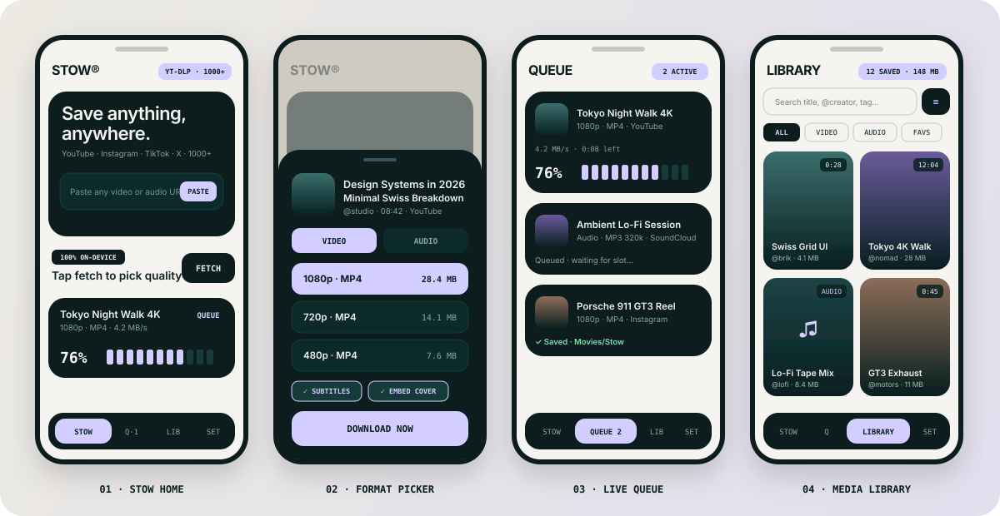
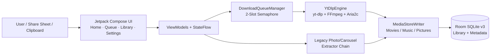

<div align="center">


# Stow®

### Free, Open-Source, 100% On-Device Universal Media Downloader for Android

**Save videos, Reels, Shorts, photos, and MP3/M4A audio from 1,000+ platforms — powered by on-device `yt-dlp` + `FFmpeg`, with zero ads, zero logins, zero tracking, and zero cloud servers.**

[](https://github.com/omkarspace/cleansaver/releases/latest)
[](https://github.com/omkarspace/cleansaver/actions)
[](https://github.com/omkarspace/cleansaver/releases)
[-F5F4F0?style=for-the-badge&labelColor=071E1F)](https://github.com/omkarspace/cleansaver/releases/latest)
[](https://kotlinlang.org)

[Download Latest APK](https://github.com/omkarspace/cleansaver/releases/latest) · [Features](#key-features) · [Screenshots](#interface-showcase) · [Supported Sites](#supported-platforms) · [FAQ](#frequently-asked-questions)

</div>

---

> **TL;DR — What is Stow?**
> **Stow** is a free, open-source Android video and audio downloader built with **Kotlin** and **Jetpack Compose**. Unlike ad-heavy downloader apps or web-based downloaders that route your links through remote servers, Stow runs **`yt-dlp`**, **`FFmpeg`**, and **`Aria2c`** **100% locally on your Android device**. It supports **1,000+ websites** (YouTube, Instagram, TikTok, X/Twitter, Reddit, Threads, Pinterest, Vimeo, SoundCloud, Twitch, and more), lets you pick exact video resolutions (`1080p`, `720p`, `480p`) or audio formats (`M4A`, `MP3 320 kbps`), embeds subtitles & album cover art, and organizes everything inside an optional biometrically locked **Library**.

---

## Interface Showcase

<div align="center">
  
</div>

*Designed with a calm **Neo-Swiss** visual language (`#F5F4F0` bone canvas, `#071E1F` deep pine blocks, `#D4CDFF` lavender accents) and bundled offline **Space Grotesk**, **Plus Jakarta Sans**, and **JetBrains Mono** typography.*

---

## Why Stow?

| Capability | **Stow** | Typical Play Store Downloaders | Cloud / Web Downloaders |
| :--- | :---: | :---: | :---: |
| **100% On-Device (`yt-dlp` + `FFmpeg`)** | ✅ | ❌ | ❌ |
| **1,000+ Supported Websites** | ✅ | ❌ (1–3 sites) | ⚠️ Varies |
| **Zero Ads, Zero Popups, Zero Paywalls** | ✅ | ❌ | ❌ |
| **No Account / Login Required** | ✅ | ⚠️ Often | ✅ |
| **Resolution Picker + MP3/M4A Audio** | ✅ | ⚠️ Paid | ⚠️ Limited |
| **Subtitles & Cover Art Embedding** | ✅ | ❌ | ❌ |
| **1-Tap In-App `yt-dlp` Updates** | ✅ | ❌ | N/A |
| **Biometric Private Library Vault** | ✅ | ❌ | ❌ |
| **Open Source & Reproducible Checksums** | ✅ | ❌ | ❌ |

---

## Key Features

### Universal On-Device Engine (1,000+ Sites)
- **Embedded `yt-dlp` + `FFmpeg` + `Aria2c`:** Powered by `youtubedl-android`, extracting streams and muxing high-bitrate video + audio directly on your phone.
- **Smart Fallback for Photos & Carousels:** Automatically falls back to Stow's native photo/carousel extractor when a post contains static images (such as Instagram photo carousels).
- **1-Tap Engine Updates:** When a platform changes its API, tap **Update yt-dlp Engine** in **Settings** to pull the latest extractors directly inside the app — no APK reinstall required.

### Format & Quality Picker Bottom Sheet
- Preview the media thumbnail, real title, creator `@handle`, duration, and platform before downloading.
- Switch between **VIDEO** (`1080p`, `720p`, `480p` MP4 with estimated file sizes) and **AUDIO** (`M4A Original` or `MP3 320 kbps`).
- Toggle **Embed Subtitles** and **Embed Cover Art / Metadata** before hitting **Download Now**.

### Dedicated Concurrent Download Queue
- Up to **2 concurrent downloads** with live segmented progress bars, real-time download speed (`MB/s`), and ETA.
- **Cancel**, **1-tap Retry** on failures, **Clear Done**, and instant **Open** or **Share** once saved.
- Paste **multiple URLs** (one per line) to batch-queue downloads automatically.

### Full-Bleed Media Library & Biometric Vault
- Clean **2-column `4:5` full-bleed grid** displaying duration badges, real titles, `@creator`, and file size.
- Filter by **All**, **Video**, **Audio**, **Photo**, **Favorites**, or custom `#collection` tags.
- Search instantly by **title**, **caption**, **`@creator`**, **platform**, or **tag**.
- Long-press for **multi-select bulk Share or Delete** (with Undo snackbar), plus optional **Fingerprint / Face / PIN Vault Lock**.

### Zero-Friction Android Integrations
- **Android Share Sheet:** Share any link from YouTube, Instagram, TikTok, X, or Reddit directly to **Stow** to open the Format Picker overlay (or enable **Instant 1-Tap Share Save** in Settings).
- **Clipboard Auto-Detect & Quick Settings Tile:** Detect copied links on focus or use the Android Quick Settings tile (*"Paste & Save"*).
- **Power-User Controls:** Custom Gallery album subfolder (`Movies/Stow`, `Music/Stow`), custom file naming (`Stow_Title` / `Creator_Title`), **Wi-Fi Only** guard, JSON library metadata backup, and an in-app **Extraction Log**.

---

## Supported Platforms

Stow supports **1,000+ websites** via `yt-dlp` plus native photo/carousel fallback, including:

- **Video & Shorts:** YouTube, YouTube Shorts, Vimeo, Twitch clips, Dailymotion, Bilibili, Loom
- **Social Media:** Instagram (Reels, Posts, Carousels), TikTok, X (Twitter), Reddit (auto-muxed video + audio), Threads, Facebook, Pinterest, Bluesky
- **Audio & Music:** SoundCloud, Bandcamp, Mixcloud, YouTube Music (extractable as `.m4a` or `.mp3`)

---

## Installation

1. Go to the [**Latest GitHub Release**](https://github.com/omkarspace/cleansaver/releases/latest).
2. Download the APK matching your phone's architecture:
   - **`app-arm64-v8a-release.apk`** — Recommended for almost all modern Android phones (2018+).
   - **`app-armeabi-v7a-release.apk`** — Older 32-bit Android devices.
   - **`app-x86_64-release.apk`** — Android emulators / Chromebooks.
3. Open the downloaded `.apk` and allow *"Install from this source"* if prompted.
4. *(Optional)* Verify file integrity against the attached `checksums.txt` (`sha256sum`).

> **Requirements:** Android 10 or higher (`minSdk 29`, `targetSdk 35`).

---

## Architecture & Tech Stack



- **Language & UI:** Kotlin 2.0, Jetpack Compose (Material 3), bundled offline fonts (`Space Grotesk`, `Plus Jakarta Sans`, `JetBrains Mono`)
- **Media Engine:** `io.github.junkfood02.youtubedl-android:0.18.1` (`library`, `ffmpeg`, `aria2c`), AndroidX Media3 ExoPlayer
- **Storage & Persistence:** Android Scoped Storage (`MediaStore`), Room Database, Jetpack DataStore Preferences
- **Networking & Images:** OkHttp 4, Kotlinx Serialization, Coil + `coil-video`
- **Security:** AndroidX Biometric (`BiometricPrompt`), ProGuard/R8 shrinking

---

## Building from Source

```bash
# 1. Clone the repository
git clone https://github.com/omkarspace/cleansaver.git
cd cleansaver

# 2. Run unit tests
./gradlew test

# 3. Build split Debug APKs (arm64-v8a, armeabi-v7a, x86_64)
./gradlew assembleDebug
```

Generated APKs will be located in `app/build/outputs/apk/debug/`.

---

## Privacy & Security

- **100% Client-Side:** Every link is resolved and downloaded directly between your device and the public media host. Stow operates **zero backend servers**.
- **Zero Telemetry:** No Firebase Analytics, no Crashlytics, no ad SDKs, and no tracking identifiers.
- **Zero Logins:** Stow never asks for your Instagram, YouTube, TikTok, or X credentials.
- **Scoped Storage Only:** Uses Android's official `MediaStore` API — no broad `MANAGE_EXTERNAL_STORAGE` permission required.

---

## Frequently Asked Questions

<details>
<summary><strong>Is Stow free and open-source?</strong></summary>

Yes. Stow is 100% free, open-source, and ad-free. You can inspect the entire Kotlin/Compose codebase in this repository or build the APK yourself from source.
</details>

<details>
<summary><strong>Which APK file should I download from GitHub Releases?</strong></summary>

Download **`app-arm64-v8a-release.apk`** for virtually any Android phone released in the last 7+ years. Use `armeabi-v7a` only for older 32-bit devices, or `x86_64` for Android emulators.
</details>

<details>
<summary><strong>Why does a link fail to download on a specific site?</strong></summary>

Social platforms frequently update their web endpoints. Open **Settings → Engine & maintenance → Update yt-dlp Engine** to pull the latest `yt-dlp` extractors directly inside Stow without waiting for a new app release. Note that private accounts, login-walled posts, and ephemeral Instagram Stories are intentionally not supported.
</details>

<details>
<summary><strong>Can Stow download audio-only MP3 or M4A files?</strong></summary>

Yes. After pasting or sharing a link, switch to the **AUDIO** tab in the Format Picker Bottom Sheet and choose either **M4A (Original)** or **MP3 (320 kbps)** with optional embedded cover art. Files are saved to `Music/Stow`.
</details>

<details>
<summary><strong>Does Stow send my pasted URLs to any third-party server?</strong></summary>

No. All extraction and downloading runs locally on your Android device via embedded `yt-dlp` and `FFmpeg`.
</details>

---

## Contributing

Contributions, bug reports, and pull requests are welcome!
1. Fork the repository and create a feature branch (`git checkout -b feat/my-feature`).
2. Run `./gradlew test` to make sure unit tests pass.
3. Open a Pull Request describing your changes.

## Disclaimer

Stow is an independent open-source utility and is not affiliated with, endorsed by, or connected to YouTube, Google, Meta (Instagram/Threads/Facebook), TikTok, X, Reddit, Pinterest, or any other platform. Please respect content creators' intellectual property, copyright laws, and platform terms of service, and only save media you have permission to use.
